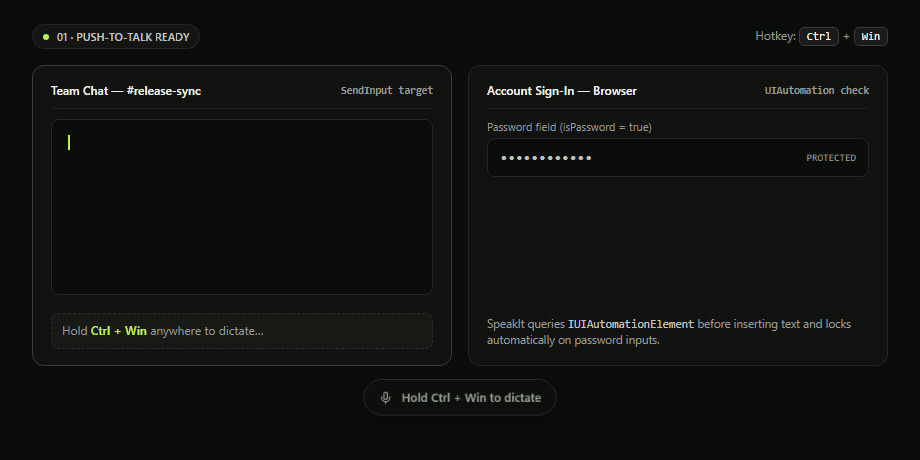
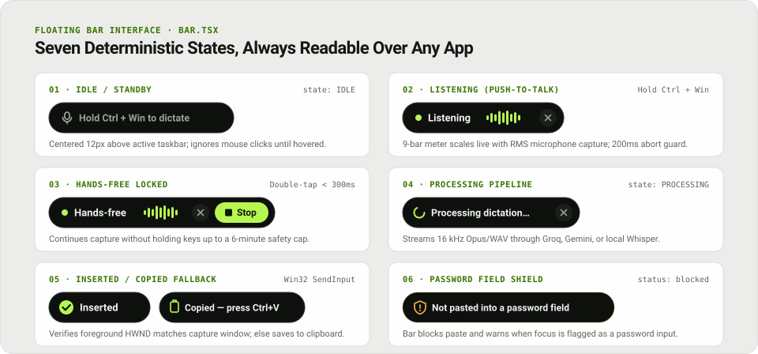
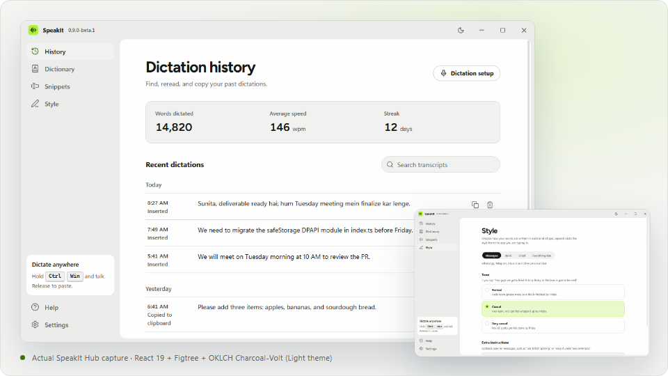
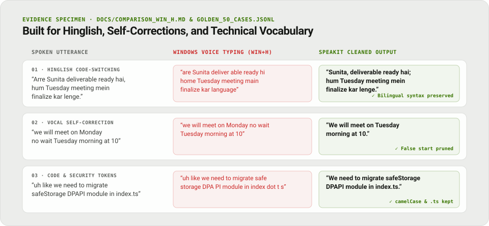
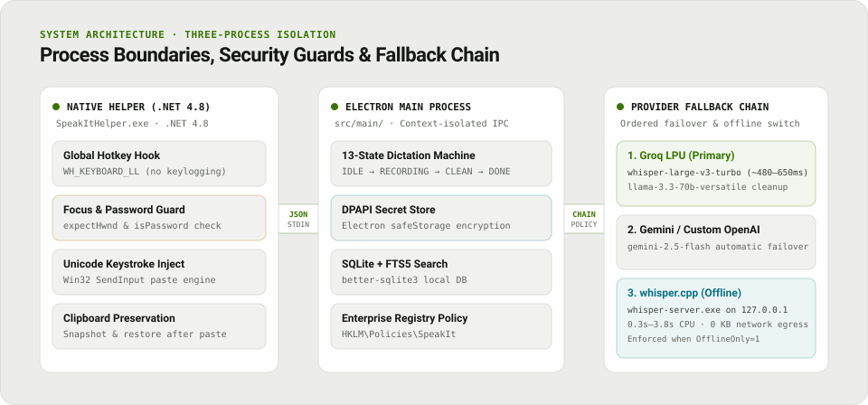

<div align="center">

<picture>
  <source media="(prefers-color-scheme: dark)" srcset=".github/assets/readme/hero/speakit-hero-dark.svg">
  <source media="(prefers-color-scheme: light)" srcset=".github/assets/readme/hero/speakit-hero-light.svg">
  
</picture>

<p align="center">
  <a href="#vi--getting-started-development-build"></a>
  <a href="docs/RELEASE.md"></a>
  <a href="docs/terms.md"></a>
</p>

<p align="center">
  <b>System-wide voice typing for Windows 10 and 11 that understands Hinglish, strips filler words and self-corrections, and works offline — free and open source.</b><br />
  Hold <kbd>Ctrl</kbd> + <kbd>Win</kbd> in any application, speak naturally, and release — formatted prose inserts directly at your cursor.
</p>

<p align="center">
  <a href="#ii--the-floating-bar-in-action">Floating Bar</a> &nbsp;·&nbsp;
  <a href="#iii--the-hub-workspace">Hub Workspace</a> &nbsp;·&nbsp;
  <a href="#iv--hinglish-self-corrections--evidence">Benchmarks</a> &nbsp;·&nbsp;
  <a href="#v--engineering-security--architecture">Architecture</a> &nbsp;·&nbsp;
  <a href="#vi--getting-started-development-build">Quick Start</a> &nbsp;·&nbsp;
  <a href="#vii--documentation--support">Docs</a>
</p>

</div>

> *SpeakIt is an independent open-source project under the MIT License and is not affiliated with, endorsed by, or sponsored by Wispr or the creators of Wispr Flow.*

---

## I · Why SpeakIt Exists

Windows built-in dictation (<kbd>Win</kbd> + <kbd>H</kbd>) writes verbatim phonetic drafts. Speak naturally with Hinglish words, mid-sentence corrections, or code identifiers, and verbatim STT breaks down:

- **Spoken:** *"Arre Sunita, um, we will meet on Monday—no wait—Tuesday morning to update safeStorage in index.ts."*
- **Windows `Win + H`:** *"are Sunita um we will meet on Monday no wait Tuesday morning to update safe storage in index dot t s"*
- **SpeakIt:** *"Sunita, we will meet on Tuesday morning to update safeStorage in index.ts."*

Cloud dictation apps solve this at **$12–$15/month** with closed cloud dependencies. SpeakIt delivers the workflow for **$0 (MIT)**, runs offline on your CPU via `whisper.cpp` or sub-second via Bring-Your-Own-Key Groq/Gemini, encrypts keys in Windows DPAPI, and collects zero telemetry.

---

## II · The Floating Bar in Action

> *"The bar is the product. Every state of the floating bar must be readable in under a second, over any app."*

SpeakIt floats 12 px above your active taskbar with click-through transparency so mouse clicks pass straight into your editor or chat window when idle.

<div align="center">
  
</div>

<details>
<summary>What happens in this workflow (text breakdown &amp; accessibility summary)</summary>

1. **Standby (`IDLE`):** Compact charcoal pill shows `Hold Ctrl + Win to dictate`.
2. **Push-to-Talk (`RECORDING`):** Holding <kbd>Ctrl</kbd> + <kbd>Win</kbd> triggers the live `#b7f652` indicator and 9-bar RMS acoustic meter while capturing 16 kHz Opus/PCM audio.
3. **Cleanup (`TRANSCRIBING` → `CLEANING`):** On release, STT + zero-temperature LLM cleanup removes fillers (`"um"`), resolves self-corrections (`"Monday no wait Tuesday"`), and applies your dictionary.
4. **Insertion (`DONE`):** The .NET helper verifies the foreground window handle (`expectHwnd`), injects Unicode via Win32 `SendInput`, and snapshots/restores your prior clipboard contents.
5. **Password Shield (`blocked`):** When the helper reports a password input, the bar and controller block paste immediately (`Not pasted into a password field`).

</details>

### Seven Deterministic Bar States

<div align="center">
<picture>
  <source media="(prefers-color-scheme: dark)" srcset=".github/assets/readme/motion/speakit-states-dark.svg">
  <source media="(prefers-color-scheme: light)" srcset=".github/assets/readme/motion/speakit-states-light.svg">
  
</picture>
</div>

---

## III · The Hub Workspace

Spend 99% of your time in other apps using the floating bar; open the **SpeakIt Hub** briefly to search transcripts via SQLite FTS5, tune per-app tone (`Messages`, `Work`, `Email`, `Everything else`), add phonetic **"Sounds like"** dictionary mappings, or configure voice snippets.

<div align="center">
<picture>
  <source media="(prefers-color-scheme: dark)" srcset=".github/assets/readme/product/speakit-hub-dark.png">
  <source media="(prefers-color-scheme: light)" srcset=".github/assets/readme/product/speakit-hub-light.png">
  
</picture>
</div>

---

## IV · Hinglish, Self-Corrections & Evidence

Evaluated against [`docs/COMPARISON_WIN_H.md`](docs/COMPARISON_WIN_H.md) and the 50-case golden prompt suite in [`test/golden/golden_50_cases.jsonl`](test/golden/golden_50_cases.jsonl) *(note: live end-to-end Hinglish WER benchmarks across audio corpora remain pending; the golden suite validates prompt rules and output guards)*:

<div align="center">
<picture>
  <source media="(prefers-color-scheme: dark)" srcset=".github/assets/readme/specimens/speakit-specimen-dark.svg">
  <source media="(prefers-color-scheme: light)" srcset=".github/assets/readme/specimens/speakit-specimen-light.svg">
  
</picture>
</div>

---

## V · Engineering, Security & Architecture

SpeakIt separates unprivileged audio/UI `WebContents`, the Electron Main state machine, and a 64-bit native Windows helper (`SpeakItHelper.exe`) communicating over line-delimited JSON stdin/stdout pipes.

<div align="center">
<picture>
  <source media="(prefers-color-scheme: dark)" srcset=".github/assets/readme/architecture/speakit-architecture-dark.svg">
  <source media="(prefers-color-scheme: light)" srcset=".github/assets/readme/architecture/speakit-architecture-light.svg">
  
</picture>
</div>

| Subsystem | Implementation & File | Verified Behavior |
|---|---|---|
| **Global Hook & Paste** | [`native/helper/src/Program.cs`](native/helper/src/Program.cs) | `WH_KEYBOARD_LL` detects configured hotkeys; `SendInput` injects Unicode text with `expectHwnd` focus checking and clipboard snapshot/restore. |
| **State Machine** | [`src/main/dictation/stateMachine.ts`](src/main/dictation/stateMachine.ts) | 13 states (`IDLE` → `ARMING` → `RECORDING` / `RECORDING_LOCKED` → `TRANSCRIBING` → `CLEANING` → `INSERTING` → `DONE`) with 200 ms abort window and 6-minute recording cap. |
| **Provider Chain** | [`src/main/providers/chain.ts`](src/main/providers/chain.ts) | Ordered failover: **Groq** (`whisper-large-v3-turbo` ~480–650 ms STT + `llama-3.3-70b-versatile`) → **Gemini 2.5 Flash** → local **`whisper.cpp`**, with automatic offline short-circuit when disconnected. |
| **Secret Store** | [`src/main/storage/secretStore.ts`](src/main/storage/secretStore.ts) | Encrypts API keys via Electron `safeStorage` (backed by Windows DPAPI). |
| **Enterprise Policy** | [`docs/ENTERPRISE_DEPLOYMENT.md`](docs/ENTERPRISE_DEPLOYMENT.md) | Reads `HKLM\Software\Policies\SpeakIt` (`OfflineOnly`, `AllowedProviders`, `DisableHistory`, `RetentionDays`) for governed deployments. |

<details>
<summary>Repository directory layout</summary>

```text
SpeakIt/
├── native/helper/          # .NET 4.8 x64 C# helper (WH_KEYBOARD_LL, UIAutomation, SendInput)
├── shared/types/           # Line-delimited JSON IPC protocol schemas
├── src/
│   ├── main/               # Electron main process (state machine, controller, providers, SQLite, DPAPI)
│   ├── preload/            # Context-isolated preload bridges (hub, bar, audio)
│   └── renderer/           # React 19 UI (Hub, Bar, Audio host, Charcoal-Volt theme tokens)
├── docs/                   # Provider limits, offline benchmarks, enterprise deployment, readiness review
└── test/                   # Golden 50-case suite, unit, contract, and soak tests
```

</details>

---

## VI · Getting Started (Development Build)

### Prerequisites
- **OS:** Windows 10 (22H2+) or Windows 11 (x64)
- **Node.js:** 22 LTS or higher
- **.NET Framework:** 4.8 (pre-installed on Windows 10 and 11)

### Setup

1. **Clone and install dependencies:**
   ```bash
   git clone https://github.com/DecoyINDIA/Speak-It.git
   cd Speak-It
   npm install --legacy-peer-deps
   ```

2. **Build the native C# helper:**
   ```bash
   dotnet build native/helper/SpeakItHelper.csproj -c Release
   ```
   Or using the built-in Windows C# compiler script (no .NET SDK required):
   ```powershell
   powershell -File native/helper/build.ps1
   ```

3. **Run in development:**
   ```bash
   npm run dev
   ```

4. **Verify tests and types:**
   ```bash
   npm run typecheck
   npm test
   npx vitest run test/unit/golden.test.ts
   ```

> **Beta Status Notice (`0.9.0-beta.1`):** SpeakIt is currently a pre-1.0 beta release. See the [Release & Packaging Guide](docs/RELEASE.md) and [Offline Benchmarks](docs/OFFLINE_BENCHMARKS.md) for current distribution, local `whisper-server.exe` setup, and hardware notes.

---

## VII · Documentation & Support

- [AI Providers & Rate Limits](docs/providers.md) — Groq, Gemini, local `whisper.cpp`, Opus payload sizes, and privacy terms.
- [Comparison vs Windows Voice Typing (`Win+H`)](docs/COMPARISON_WIN_H.md) — Feature matrix and sample utterance transcripts.
- [Offline Performance Benchmarks](docs/OFFLINE_BENCHMARKS.md) — `whisper-tiny` / `whisper-small` CPU timings (`0.3s–3.8s`) across hardware tiers.
- [Enterprise & Group Policy Deployment](docs/ENTERPRISE_DEPLOYMENT.md) — Silent NSIS flags and `HKLM\Software\Policies\SpeakIt` keys.
- [Why SpeakIt Needs Input Access](docs/WHY_ACCESSIBILITY_PERMISSIONS.md) — Transparent breakdown of hooks, `SendInput`, and UI Automation.
- [Release & Packaging Guide](docs/RELEASE.md) — Build, installer packaging, and release checklist.
- [Troubleshooting & Known Limits](docs/troubleshooting.md) · [Terms of Use](docs/terms.md) · [Privacy Policy](docs/privacy.md) · [Contributing](CONTRIBUTING.md)

SpeakIt costs $0 to run. If it saves you time every day, consider supporting maintenance:  
[Sponsor on GitHub](https://github.com/sponsors/DecoyINDIA) · [Buy Me a Coffee](https://buymeacoffee.com/DecoyINDIA)

---

Licensed under the MIT License (see [Terms of Use](docs/terms.md)). Independent open-source project — not affiliated with Wispr or Wispr Flow.
