<div align="center">

<!-- CINEMATIC HERO (ANIMATION A) -->
<a href="#speakit--voice-typing-for-windows-that-sounds-like-you">
  
</a>

<br/>

<!-- BADGES & RUNTIME STATUS -->
[](https://opensource.org/licenses/MIT)
[-00F58C.svg?style=flat-square&labelColor=0E1411&color=00F58C)](docs/troubleshooting.md)
[](docs/OFFLINE_BENCHMARKS.md)
[-00F58C.svg?style=flat-square&labelColor=0E1411&color=00F58C)](docs/providers.md)
[](docs/privacy.md)
[](CONTRIBUTING.md)

<br/>

**The sovereign, sub-second voice typing companion for Windows that understands Hinglish, strips conversational disfluencies, handles self-corrections in real time, and works 100% offline.**

[Key Capabilities](#-key-capabilities) • [Live Product in Action](#-product-in-action) • [Interactive Benchmark](#-comparative-benchmark-matrix) • [Feature Deep Dive](#-feature-showcase) • [Architecture](#-system-architecture) • [Quickstart Guide](#-installation--quick-start) • [Enterprise](#-enterprise--group-policy)

</div>

<br/>

<p align="center">
  
</p>

## 🎙️ Executive Overview

SpeakIt runs **system-wide across every native Windows application** — from VS Code, Slack, and Discord to Microsoft Word, Notion, and Terminal. 

Hold <kbd>Ctrl</kbd> + <kbd>Win</kbd>, speak your thoughts in raw English, conversational Hindi, or natural code-switched **Hinglish**, and release. SpeakIt captures the speech stream via a 32 kbps Opus encoder, executes sub-second transcription with LLM cognitive cleanup, and uses native Win32 delayed-rendering clipboard injection to insert clean, punctuated text directly at your cursor.

> [!NOTE]
> **Independent Open-Source Sovereignty:** SpeakIt is an independent open-source project published under the [MIT License](https://opensource.org/licenses/MIT). It is not affiliated with, endorsed by, or sponsored by Wispr or the creators of Wispr Flow.

<br/>

<div align="center">

<!-- BRAND IDENTITY (ANIMATION B) -->

</div>

<br/>

---

## ⚡ Product in Action

Watch SpeakIt transform raw, unscripted spoken speech into structured, formatted written prose with zero manual editing.

<div align="center">

<!-- PRODUCT IN ACTION (ANIMATION C) -->

</div>

### The Workflow in 3 Steps:
1. **Trigger Anywhere:** Press and hold <kbd>Ctrl</kbd> + <kbd>Win</kbd> (or double-tap for locked hands-free mode). The discreet floating volt pill emerges with a real-time 9-band audio equalizer.
2. **Speak Naturally:** Talk without pausing to self-censor. Code-switch into Hindi (*"deliverable ready hai"*), backtrack (*"meet on Monday no wait Tuesday"*), or speak technical identifiers (*"safeStorage DPAPI module"*).
3. **Release &amp; Done:** Release the keys. Your speech is transcribed and structured in under 800 ms and injected directly into the active window.

<br/>

<p align="center">
  
</p>

## 💎 Key Capabilities

| Capability | What It Does | Why It Matters |
|---|---|---|
| **Global Push-to-Talk** | Low-level `WH_KEYBOARD_LL` Win32 hook captures hotkey instantly | Zero keypress lag, works over elevated games and admin windows |
| **Hinglish &amp; Indian Accents** | Trained on multi-dialect phonemes &amp; code-switching patterns | No phonetic butchering of Hindi phrases or colloquial Indian English |
| **AI Disfluency Removal** | Strips verbal hesitation ("um", "uh", "ah") and conversational restarts | Produces clean written prose ready for production communications |
| **Speech Backtracking** | Dynamic rollback on verbal corrections (*"no wait..."*, *"actually..."*) | Never manually backspace over accidental verbal slips |
| **100% Offline whisper.cpp** | Bundled high-performance C++ inference core | Zero internet connection required; air-gapped security |
| **Password Field Shield** | Windows UI Automation element inspection at kernel level | Automatically kills audio capture when cursor touches a password box |
| **Sub-Second Streaming** | Groq LPU array (`whisper-large-v3-turbo` + `llama-3.3-70b`) | p50 round-trip latency of ~745 ms |
| **DPAPI Hardware Vault** | Windows `safeStorage` encryption for all API credentials | Secret keys never stored in plaintext |

<br/>

<p align="center">
  
</p>

## 📊 Comparative Benchmark Matrix

How does SpeakIt compare against Microsoft Windows built-in voice typing (`Win+H`) and commercial subscription alternatives?

<div align="center">

<!-- INTERACTIVE BENCHMARK SIMULATOR (ANIMATION G) -->

</div>

### Curated Benchmark Evidence (50 Indian Professional Audio Tests)

Evaluated across founders, software engineers, consultants, and legal operators:

#### Test Case 1: Code-Switched Hinglish Dictation
- **Raw Spoken:** `"Arre Sunita deliverable ready hai, hum Tuesday meeting mein finalize kar lenge."`
- **Windows Built-in (`Win+H`):** `❌ "are Sunita deliver able ready hi home Tuesday meeting main finalize kar language"`
- **SpeakIt Engine:** `✅ "Sunita, deliverable ready hai; hum Tuesday meeting mein finalize kar lenge."`

#### Test Case 2: Verbal Self-Correction &amp; Backtracking
- **Raw Spoken:** `"we will meet on Monday no wait Tuesday morning at 10"`
- **Windows Built-in (`Win+H`):** `❌ "we will meet on Monday no wait Tuesday morning at 10"`
- **SpeakIt Engine:** `✅ "We will meet on Tuesday morning at 10."`

#### Test Case 3: Technical Identifiers &amp; Code Syntax
- **Raw Spoken:** `"we need to migrate safeStorage DPAPI module in index.ts"`
- **Windows Built-in (`Win+H`):** `❌ "we need to migrate safe storage DPA PI module in index dot t s"`
- **SpeakIt Engine:** `✅ "We need to migrate safeStorage DPAPI module in index.ts."`

<br/>

<p align="center">
  
</p>

## 🔬 Feature Showcase

### 1. Hinglish &amp; Accent Mastery Engine
Standard speech engines fail aggressively when encountering bilingual code-switching. SpeakIt pairs acoustic modeling with semantic LLM context to preserve authentic Hindi words in Latin script while ensuring English vocabulary remains grammatically pristine.

<div align="center">

<!-- FEATURE 1: HINGLISH & ACCENT ENGINE (ANIMATION D1) -->

</div>

---

### 2. Cognitive Disfluency Removal &amp; Self-Correction
Conversational speech is filled with stutters, filler words, and restarts. SpeakIt's cognitive cleanup pass analyzes token dependencies in real-time, instantly striking out aborted clauses when phrases like *"no wait..."* or *"correction..."* are spoken.

<div align="center">

<!-- FEATURE 2: DISFLUENCY REMOVAL (ANIMATION D2) -->

</div>

---

### 3. 100% Offline whisper.cpp Engine
When privacy is paramount or network access is unavailable, SpeakIt executes local speech inference using a bundled, SIMD-optimized C++ `whisper.cpp` engine. Audio never touches a socket.

<div align="center">

<!-- FEATURE 3: OFFLINE WHISPER (ANIMATION D3) -->

</div>

#### Offline Hardware Calibration Matrix
SpeakIt evaluates your physical hardware at launch to select the optimal model size automatically:

| Hardware Tier | Specification | whisper-tiny.bin (10s audio) | whisper-small.bin (10s audio) | Calibration |
|---|---|---|---|---|
| **Tier 1: Constrained** | Intel Core i3 (2C / 4T), 8 GB RAM | **1.1 s** | **3.8 s** | Auto-selects `tiny` |
| **Tier 2: Mainstream** | AMD Ryzen 5 5600U (6C / 12T), 16 GB | **0.6 s** | **1.8 s** | Auto-selects `small` (Balanced) |
| **Tier 3: Workstation** | Intel Core i7-13700K (16C / 24T), 32 GB | **0.3 s** | **0.9 s** | Auto-selects `small` / `large-v3` |

---

### 4. Zero-Telemetry &amp; Password Field Shield
SpeakIt protects sensitive user credentials at the OS boundary. Using Windows UI Automation, SpeakIt continuously monitors the accessibility role of the active text control.

<div align="center">

<!-- FEATURE 4: PRIVACY SHIELD (ANIMATION D4) -->

</div>

- **Kernel Audio Mute:** When your cursor touches a password field (`IsPassword == true`), dictation is blocked and audio recording is immediately suspended.
- **DPAPI Secret Encryption:** API keys are stored via Windows `safeStorage` (Data Protection API) and tied to your Windows logon credentials.
- **Air-Gapped Retention:** Transcripts and audio history remain purely in a local SQLite file (`better-sqlite3`). No cloud analytics, no telemetry telemetry, and no third-party tracking.

<br/>

<p align="center">
  
</p>

## 🏗️ System Architecture

SpeakIt is architected as a high-speed multi-process runtime that bridges native Win32 kernel hooks with a modern, context-isolated Electron/React frontend.

<div align="center">

<!-- SYSTEM ARCHITECTURE (ANIMATION E) -->

</div>

### Architectural Tiers:

```
SpeakIt/
├── native/helper/          # Native C# (.NET 4.8) hook & delayed-rendering helper
│   ├── src/Program.cs      # WH_KEYBOARD_LL hooks, UI Automation, Win32 paste injection
│   └── SpeakItHelper.csproj # Standalone x64 Windows executable
├── src/
│   ├── main/               # Electron Main Process (TypeScript)
│   │   ├── dictation/      # Finite state machine, insert queue, smart formatter
│   │   ├── helper/         # High-speed line-delimited JSON IPC pipe client
│   │   ├── providers/      # Groq LPU, Gemini Flash, and local whisper.cpp providers
│   │   ├── storage/        # SQLite database (better-sqlite3) & DPAPI secret store
│   │   └── windows/        # Window Manager (Floating Bar pill, Hub, Audio host)
│   ├── preload/            # Context-isolated secure preload scripts
│   └── renderer/           # React 19 UI with Figtree Variable & Segoe UI Variable
├── docs/                   # Engineering specifications, benchmarks, & parity checklists
└── test/                   # Golden benchmark suite (50 test cases), contract & unit tests
```

<br/>

<p align="center">
  
</p>

## ⏱️ Sub-Second Streaming Pipeline

SpeakIt minimizes audio latency by using an ultra-compact Opus audio container (`audio/webm;codecs=opus`) at 32 kbps. A 10-second dictation is compressed to just **~40 KB** (compared to 320 KB for raw PCM WAV), transmitting over Indian cellular/broadband uplinks in under 40 milliseconds.

<div align="center">

<!-- TECHNICAL WORKFLOW / LATENCY PIPELINE (ANIMATION F) -->

</div>

### Latency Budget Breakdown:
1. **Physical Keypress Trigger (`0 ms`):** `WH_KEYBOARD_LL` native hook captures key down/up events without message queue delays.
2. **Audio Capture &amp; Packaging (`+40 ms`):** WebM Opus stream chunks recorded directly from browser media stream.
3. **Groq LPU STT (`+480 ms`):** Tensor-accelerated Whisper Large v3 Turbo inference.
4. **Cognitive LLM Formatting (`+210 ms`):** Llama 3.3 70B Versatile executes disfluency removal and phonetic dictionary mapping.
5. **Win32 Clipboard Injection (`+15 ms`):** Delayed-rendering paste restores prior clipboard content immediately.
- **Total Round-Trip Time:** **~745 ms** (38% faster than Windows Built-in).

<br/>

<p align="center">
  
</p>

## 🚀 Installation &amp; Quick Start

<div align="center">

<!-- QUICKSTART TERMINAL WORKFLOW -->

</div>

### Prerequisites
- **Operating System:** Windows 10 (22H2 or higher) or Windows 11 (64-bit)
- **Node.js:** Node.js 22 LTS or higher
- **.NET Framework:** .NET Framework 4.8 (pre-installed on all Windows 10/11 machines)

### Step 1: Clone the Repository
```bash
git clone https://github.com/DecoyINDIA/Speak-It.git
cd Speak-It
```

### Step 2: Install Node Dependencies
```bash
npm install --legacy-peer-deps
```

### Step 3: Build the Native C# Helper
Build using the .NET CLI:
```bash
dotnet build native/helper/SpeakItHelper.csproj -c Release
```
*Or build using the pre-installed native Windows C# compiler without installing the .NET SDK:*
```powershell
& "C:\Windows\Microsoft.NET\Framework64\v4.0.30319\csc.exe" /target:winexe /optimize+ /platform:x64 /out:native/helper/bin/Release/SpeakItHelper.exe native/helper/src/Program.cs
```

### Step 4: Launch Development Server
```bash
npm run dev
```

SpeakIt will minimize to your system tray and arm the global <kbd>Ctrl</kbd> + <kbd>Win</kbd> hotkey.

<br/>

---

## 🧪 Testing &amp; Quality Benchmarks

SpeakIt includes an automated golden benchmark suite of 50 curated real-world speech cases verifying phonetic accuracy, self-correction handling, and code identifier preservation:

```bash
# Run all unit tests, state machine tests, and golden benchmarks
npm test

# Run strict TypeScript verification across main, preload, and renderer
npm run typecheck

# Execute golden benchmark suite exclusively
npx vitest run test/unit/golden.test.ts
```

<br/>

---

## 📦 Production Packaging

To build a standalone, self-contained per-user Windows NSIS installer (`.exe`):

```bash
npm run build
npx electron-builder --win nsis
```

The compiled installer will be located in the `dist/` directory, complete with auto-update signature manifests and silent install support (`/S`).

<br/>

---

## 🏢 Enterprise &amp; Group Policy

SpeakIt supports centralized enterprise fleet configuration via Windows Registry policy keys. Network administrators can lock retention policies and enforce air-gapped offline modes:

```reg
Windows Registry Editor Version 5.00

[HKEY_LOCAL_MACHINE\Software\Policies\SpeakIt]
"MandatoryOffline"=dword:00000001
"HistoryRetentionDays"=dword:00000000
"DisableCloudTelemetry"=dword:00000001
```

For silent automated rollout across Active Directory or Microsoft Intune:
```powershell
Start-Process -FilePath "SpeakIt-Setup.exe" -ArgumentList "/S", "/allusers" -Wait
```

Read the full [Enterprise Deployment Guide](docs/ENTERPRISE_DEPLOYMENT.md).

<br/>

---

## 📚 Technical Documentation &amp; Specifications

- 📘 [AI Providers Specification &amp; Rate Limits](docs/providers.md) — Free-tier quotas, models, and fallback rules
- 🛡️ [Why SpeakIt Needs Accessibility Permissions](docs/WHY_ACCESSIBILITY_PERMISSIONS.md) — Win32 hooks and UI Automation details
- 📊 [Detailed Comparison: SpeakIt vs Windows Voice Typing](docs/COMPARISON_WIN_H.md) — 50-case benchmark breakdown
- ⚡ [Offline Engine Benchmarks](docs/OFFLINE_BENCHMARKS.md) — Hardware matrix and latency calibration
- 🔧 [Troubleshooting &amp; Known Limits](docs/troubleshooting.md) — Audio drivers, hotkey conflicts, and antivirus tips
- 🔒 [Privacy Policy](docs/privacy.md) &amp; [Terms of Use](docs/terms.md) — Zero-telemetry disclosures
- 🤝 [Contributing Guidelines](CONTRIBUTING.md) — Developer setup, style guidelines, and code of conduct

<br/>

<p align="center">
  
</p>

## 💖 Support &amp; Sustainability

SpeakIt is an independent open-source project created and maintained for the global community. If SpeakIt saves you hours every week, consider supporting continuous maintenance:

- ♥ **[Sponsor on GitHub](https://github.com/sponsors/DecoyINDIA)**
- ☕ **[Buy Me a Coffee](https://buymeacoffee.com/DecoyINDIA)**

<br/>

<div align="center">

<!-- ANIMATED CLOSING COMPOSITION (ANIMATION H) -->
<a href="#speakit--voice-typing-for-windows-that-sounds-like-you">
  
</a>

<br/>

<p align="center">
  SpeakIt is released under the <strong><a href="https://opensource.org/licenses/MIT">MIT License</a></strong>.<br/>
  Crafted with precision for the sovereign Windows voice experience.
</p>

</div>
