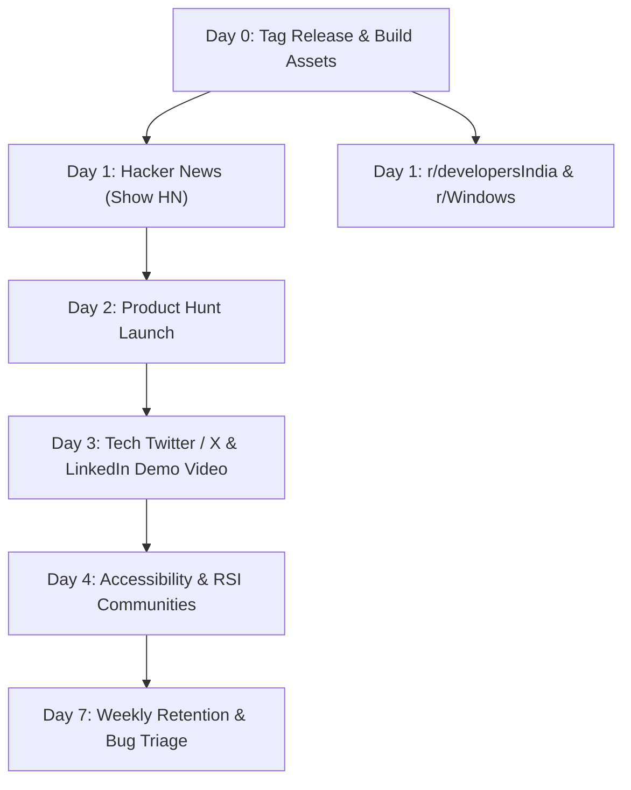

# SpeakIt — Go-To-Market & Launch Playbook (BG8)

| | |
|---|---|
| Target Date | Post-M7 Public Release Gate (v0.9.0-beta.1 / v1.0.0) |
| Positioning | **"Voice typing for Windows that understands Hinglish, cleans up your speech, and works offline — free and open source."** |
| Target Personas | Indian engineers, tech founders, consultants, operators, and writers typing on Windows |

---

## 1. Core Channels & Timeline



---

## 2. Channel Playbooks

### Channel A: Hacker News (Show HN)
- **Title:** `Show HN: SpeakIt – Voice typing for Windows that understands Hinglish and runs offline`
- **Post Body:**
  ```text
  Hi HN,

  I built SpeakIt because Windows voice typing (Win+H) completely butchers mixed Indian English and Hinglish speech, doesn't strip filler words or self-corrections, and Wispr Flow costs $15/month with zero offline support.

  SpeakIt is a free, open-source (MIT) Windows desktop app with:
  1. Hold Ctrl+Win to dictate anywhere in Windows.
  2. Native Hinglish & Indian English support (tested against 50 realistic work scenarios).
  3. AI disfluency cleaning (filters "um", "uh", and handles "meet Monday no wait Tuesday" -> "meet Tuesday").
  4. 100% Offline mode via bundled whisper.cpp.
  5. Privacy-first: Zero telemetry, zero accounts, no server operated by the author.

  GitHub: https://github.com/DecoyINDIA/Speak-It
  Download installer: https://github.com/DecoyINDIA/Speak-It/releases/latest

  Would love your honest feedback!
  ```

### Channel B: Reddit (r/developersIndia & r/Windows)
- **Focus:** Highlight the Hinglish benchmarks, developer use cases (dictating git commits, PR descriptions, Slack messages), and open-source BYOK nature.
- **Title:** `I built a free open-source alternative to Wispr Flow for Windows that actually understands Indian accents and Hinglish (with full offline mode)`

### Channel C: Product Hunt
- **Tagline:** Free, offline voice typing for Windows that sounds like you.
- **Assets:** 30s demo video showing dictation into Slack and VS Code, 5 screenshot cards, clean download link.

### Channel D: Accessibility & Ergonomics Communities
- Target users dealing with Repetitive Strain Injury (RSI), carpal tunnel syndrome, or motor accessibility needs on Windows who need reliable, zero-subscription voice-to-text.

---

## 3. Winget Installation Distribution

Users can install with a single command once published:
```cmd
winget install DecoyINDIA.SpeakIt
```
Manifests are prepared under `winget/manifests/`.
